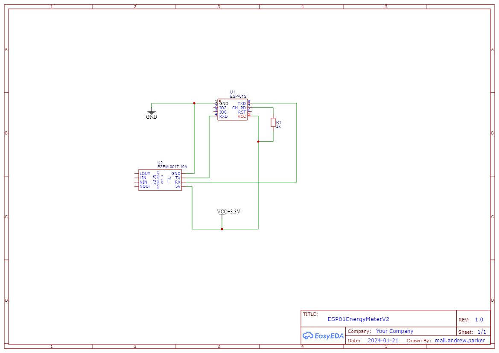

# ESP01EnergyMeterV2

ESP-01S (ESP8266, 1 MB) reading a Peacefair PZEM-004T v3.0 over the hardware UART and
exposing the values over HTTP. Static IP `192.168.100.23`, logs sent as JSON over UDP to
`192.168.100.134:5000` / `:5010`.



## HTTP API

| Method | Path      | Description                                   |
|--------|-----------|-----------------------------------------------|
| GET    | `/`       | Device / flash / WiFi info + firmware upload  |
| GET    | `/data`   | voltage, current, power, energy, frequency, pf |
| GET    | `/health` | `{"status":"UP"}`                             |
| POST   | `/update` | OTA firmware update                           |

## Build

1. `cp include/WiFiConfig.example.h include/WiFiConfig.h` and fill in `LOCAL_SSID` / `LOCAL_KEY`
   (the file is git-ignored; without it the build uses placeholders and prints a warning).
2. `pio run`

## Flash

- Serial (USB-UART on COM5): `pio run -e esp01_1m -t upload`
- OTA over WiFi: `pio run -e esp01_1m_ota -t upload` (or upload `.pio/build/esp01_1m_ota/firmware.bin` from `/`)

## Project layout

```
src/main.cpp          application: HTTP routes, PZEM readout
lib/WiFiHelper        WiFi connect, static IP, status LED, reconnect watchdog
lib/ServerHelper      index page / 404 handler
lib/Logger            JSON UDP logger
include/              WiFiConfig.h (local credentials)
docs/                 schematic and photos
```

Board settings carried over from the original Arduino/Sloeber config: 160 MHz, flash 1M (no FS)
DOUT 40 MHz, lwIP v2 low memory, reset method `ck`, `LED_BUILTIN=2`.
